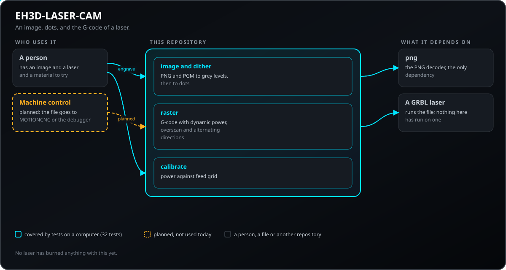
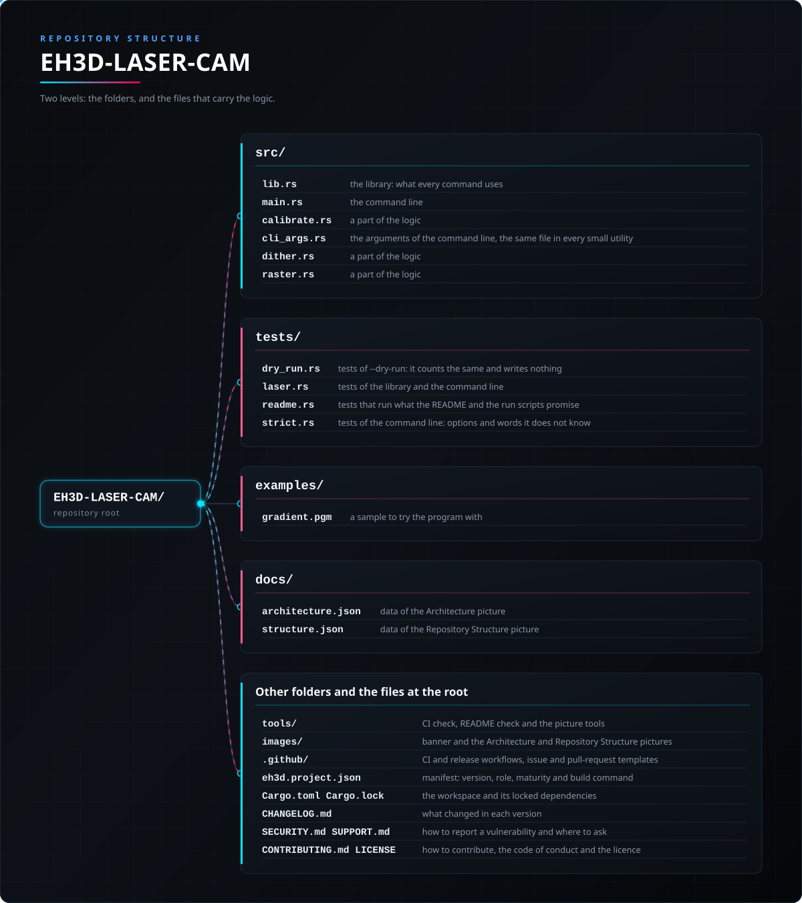

<p align="center">
  
</p>

#  EH3D-PHOENIX-LASER
<p align="center"><a href="README.md">🇺🇸 English</a> | <a href="README_spa.md">🇪🇸 Español</a> | 🇫🇷 <b>Français</b> | <a href="README_ita.md">🇮🇹 Italiano</a> | <a href="README_deu.md">🇩🇪 Deutsch</a> | <a href="README_zho.md">🇨🇳 中文</a> | <a href="README_jpn.md">🇯🇵 日本語</a> | <a href="README_por.md">🇵🇹 Português</a></p>

### Gravure laser à partir d'une image : tramage, G-code raster et grille d'étalonnage

<p align="center">
  
  
  
  
  
</p>

---

**Vérification d'honnêteté - ce qui fonctionne aujourd'hui :** une bibliothèque Rust et un programme en ligne de commande (`phoenix-laser`) avec 125 tests exécutés sur un ordinateur : transforme une image en points par tramage et écrit le G-code d'un laser qui brûle ligne par ligne avec puissance dynamique et dépassement, plus une grille d'essai puissance contre avance. Il a une fenêtre (compilée avec `--features gui`) qui ouvre une image PNG ou PGM, montre les passes du laser colorées selon la puissance, permet de régler la puissance, l'avance et les points, et exporte le G-code, mais la fenêtre n'a pas encore été vue sur un écran ; n'a pas été essayé sur une machine et n'a pas été vérifié sur une collection de fichiers réels.

---

> **État de sécurité :** ce programme ne commande aucune machine et n'est pas un système de sécurité. Ce qu'il produit doit être vérifié par une personne avant tout essai sur une machine ; rien ici n'a fonctionné sur du matériel réel.


## 📋 En un coup d'œil

| | |
|---|---|
| Version | `0.0.3` |
| Maturité | Échafaudage |
| Tests | 125 |
| Pile technique | Rust |
| Sur du matériel réel | Non essayé : rien ici n'a fonctionné sur une machine |

**Aller à  :** [Présentation](#-présentation) · [Architecture](#-architecture) · [Démarrage rapide](#-démarrage-rapide) · [Tests](#-tests) · [Structure](#-structure-du-dépôt) · [Liés](#-projets-liés)

## 🚦 État du projet

Chaque ligne est une partie de ce dépôt et le feu dit où elle en est aujourd'hui. Elle est écrite d'après ce que le dépôt peut montrer (tests, compilations, exécutions), pas d'après ce qui est prévu.

🟢 Fait et vérifié · 🟡 Fonctionne, avec des limites connues · 🟠 À moitié fait ou pas encore vérifié · 🔴 Pas fait ou ne fonctionne pas

| Domaine | État | Ce que cela veut dire ici |
|---|---|---|
| Cœur | 🟡 | transforme une image en points par tramage et écrit le G-code d'un laser qui brûle ligne par ligne avec puissance dynamique et dépassement, plus une grille d'essai puissance contre avance ; testé sur un ordinateur avec des entrées normales et abîmées, pas avec une collection de fichiers réels. |
| Ligne de commande | 🟡 | `phoenix-laser` exécute les mêmes fonctions que la bibliothèque et affiche le résultat ; chaque erreur revient sous forme de message et de code de sortie non nul. |
| Tests | 🟡 | 125 tests passent (`cargo test`), avec des cas normaux, des cas limites et des entrées abîmées. |
| Sécurité | 🟡 | Rust sûr et simple (`forbid(unsafe_code)`) : rien ne panique sur les fichiers reçus et une mauvaise valeur est une erreur avec sa raison ; pas de revue indépendante. |
| Fenêtre | 🟠 | Écrite (egui, `--features gui`) : ouvrir ou déposer une image, voir les passes du laser colorées selon la puissance, régler les points, la puissance et l'avance, une grille d'étalonnage, zoom et déplacement, exporter ; sa logique est testée, mais elle n'a pas encore été compilée ni vue sur un écran. |
| Matériel réel | 🔴 | Non essayé : rien ici n'a été exécuté sur une machine. |
| Documentation | 🟡 | README en huit langues, le journal des modifications et les deux images dessinées depuis `docs/`. |

## 🎯 Présentation

* **L'image** (`eh3d-image`) : PNG (gris, couleur, transparent, 8 ou 16 bits) et PGM (texte et binaire) deviennent des niveaux de gris, les parties transparentes comptant comme blanc et la taille étant limitée pour qu'un fichier hostile ne puisse pas réclamer des gigaoctets ; `resize` moyenne les pixels pour qu'un point soit aussi gros que le faisceau.
* **Les points** (`src/dither.rs`) : un seuil ou une diffusion d'erreur de Floyd-Steinberg ou d'Atkinson ; les tests vérifient que l'obscurité d'un gris est conservée (un gris moyen brûle environ la moitié des points) et que le blanc ne brûle rien et le noir tout.
* **Le laser** (`src/raster.rs`, `src/calibrate.rs`) : une ligne après l'autre, de gauche à droite puis de droite à gauche, `M4` avec `S0` pendant le déplacement et la puissance choisie là où il brûle, un dépassement fixe ou calculé avec l'accélération (v au carré sur 2a) et une grille de carrés avec une puissance par colonne et une avance par ligne pour trouver ce qui convient à un matériau.
* **L'en-tête et les nombres de tout fichier de G-code** (`src/gcode_out.rs`) : le fichier s'ouvre sur des lignes de commentaire qui disent le générateur et sa version, les unités (mm, G21), l'image dont il vient avec son SHA-256 et les outils (le laser et sa puissance) ; une grille d'étalonnage dit qu'elle n'a pas de source. Un nombre s'écrit d'une seule façon (trois décimales au plus, pas de `-0`) et une valeur non finie est refusée au lieu d'être écrite `NaN` ou `inf`.
* **`--dry-run` :** `engrave` calcule le résultat et le compte (points, lignes, passages, longueur brûlée, temps) sans écrire le fichier de sortie, qui peut alors être omis.

## 🧩 Rôle dans EH3D

EH3D-PHOENIX-LASER est un programme de l'EH3D Fabrication Suite. Il fonctionne comme bibliothèque et ligne de commande et, compilé avec `--features gui`, comme fenêtre avec l'aspect commun aux autres programmes de la suite. Il lit et écrit des fichiers simples et peut donc s'utiliser seul ou entre les autres programmes.

## 🏛️ Architecture

<p align="center">
  
</p>


Comment les parties de ce dépôt s'articulent : qui l'utilise, ce qu'il contient et de quoi il dépend. L'image est dessinée depuis `docs/architecture.json` et vérifiée avec le code.

## ✨ Fonctionnalités

* **Une bibliothèque et une ligne de commande :** chaque commande de `phoenix-laser` est une fonction de la bibliothèque ; un autre programme de la suite peut l'appeler sans lancer de processus.
* **Ligne de commande stricte :** une option mal écrite (`--powr`) ou un mot en trop est une erreur qui la nomme, et non quelque chose d'ignoré ; sinon le programme ferait sa sortie avec les valeurs par défaut.
* **Tests avec entrées abîmées :** les tests fournissent aussi des fichiers vides, du bruit, des nombres énormes et des fichiers coupés, et aucun ne doit paniquer.
* **Sans deviner :** une valeur absurde est une erreur qui dit laquelle et pourquoi, jamais un résultat qui n'en a que l'air.
* **Pas de code unsafe :** `#![forbid(unsafe_code)]` dans la bibliothèque et le programme.

## 🔒 Sécurité et protection

| Menace | Défense |
|---|---|
| Un fichier abîmé, coupé ou vide | pas de panique : les tests coupent une entrée valide à chaque position et fournissent du bruit |
| Un nombre absurde (négatif, non fini, démesuré) | refusé avec une erreur qui nomme la valeur ; rien n'est arrondi en quelque chose de plausible |
| Usage non sûr de la mémoire | Rust sûr et simple avec `forbid(unsafe_code)` |

**Ce qui n'est pas défendu :** un résultat produit sans erreur n'est pas un résultat vérifié. Rien ici ne connaît les limites d'une machine et le programme n'a pas eu de revue indépendante. Signalez une vulnérabilité en privé (voir [SECURITY.md](SECURITY.md)).

## 🔌 Interfaces

La bibliothèque est `eh3d_phoenix_laser` (`use eh3d_phoenix_laser::...`) ; la ligne de commande est `phoenix-laser`. Les commandes sont celles-ci ; chacune affiche son résultat sur la sortie standard et signale une erreur sur la sortie d'erreur avec un code de sortie non nul. Il n'y a pas d'accès réseau.

```text
phoenix-laser engrave IMAGE OUT.nc --width-mm 50 [--dot-mm 0.1] [--feed 3000] [--power 50] [--smax 1000]
              [--dither fs|atkinson|threshold] [--threshold 128] [--overscan MM|auto] [--accel 1000] [--origin X,Y] [--dry-run]
phoenix-laser calibrate OUT.nc --powers 20,40,60,80 --feeds 1000,2000,3000 [--smax 1000]
phoenix-laser info IMAGE
phoenix-laser [gui] [IMAGE]                      the window (a build with --features gui); with no arguments it opens
```

## ⚙️ Configuration

Il n'y a pas encore de fichier de configuration : ce que la personne choisit est donné en arguments de la ligne de commande (voir Interfaces) et chaque valeur par défaut est écrite dans l'aide de la commande (`phoenix-laser help`). Les limites fixes sont des constantes nommées dans le code, couvertes par des tests.

## 🚀 Démarrage rapide

Il faut une chaîne d'outils Rust stable (1.88 ou plus récente). Le dépôt EH3D-COMMON doit être cloné à côté de celui-ci : le lecteur d'images en est pris par chemin.

```bash
cargo build --release
cargo test
cargo run --release -- engrave examples/gradient.pgm examples/gradient.nc --width-mm 16 --dot-mm 0.5 --overscan auto
cargo run --release --features gui   # the window
```

## 🧪 Tests

La suite compte 125 tests (`cargo test`, exécutés sous Windows et Linux dans le CI). Ils vérifient les cas normaux, les cas limites et les entrées abîmées : fichiers vides, bruit et fichiers coupés ne font jamais paniquer. Le CI exécute aussi `cargo fmt --check`, `cargo clippy` avec les avertissements comme erreurs et `python -I tools/ci_validate.py`.

## 🏗️ Compilation et publication

La version se trouve dans `Cargo.toml` et `eh3d.project.json` ; chaque version a son entrée dans [CHANGELOG.md](CHANGELOG.md). `build.bat` / `build.sh` compilent le programme, `test.bat` / `test.sh` lancent les tests et `run.bat` / `run.sh` l'exécutent avec un exemple. Les versions sont publiées sur GitHub.

## 📂 Structure du dépôt

<p align="center">
  
</p>

<details>
<summary>Version texte de l'arborescence</summary>

```text
EH3D-PHOENIX-LASER/
├── src/
│   ├── lib.rs                                   la bibliothèque : ce que chaque commande utilise
│   ├── main.rs                                  la ligne de commande
│   ├── calibrate.rs                             une partie de la logique
│   ├── cli_args.rs                              les arguments de la ligne de commande, le même fichier dans chaque petit utilitaire
│   ├── dither.rs                                une partie de la logique
│   ├── gcode_out.rs                             la seule façon d'écrire un nombre de G-code et l'en-tête standard
│   ├── raster.rs                                une partie de la logique
│   ├── browse.rs                                la liste des fichiers de la fenêtre d'ouverture d'un fichier
│   ├── gui.rs                                   la fenêtre (egui, avec la fonctionnalité gui) : dessine l'état et transmet ce que fait la personne
│   ├── lang.rs                                  les mots de la fenêtre dans les huit langues
│   ├── viewport.rs                              zoom et déplacement de l'image, en simples nombres
│   └── window.rs                                l'état de la fenêtre sans écran : image, réglages, passes et export
├── tests/
│   ├── dry_run.rs                               tests de --dry-run : compte la même chose et n'écrit rien
│   ├── laser.rs                                 tests de la bibliothèque et de la ligne de commande
│   ├── readme.rs                                tests qui exécutent ce que promettent le README et les scripts run
│   ├── strict.rs                                tests de la ligne de commande : options et mots qu'elle ne connaît pas
│   └── window_cli.rs                            tests qu'une compilation sans la fonctionnalité gui reste une ligne de commande
├── examples/
│   └── gradient.pgm                             un exemple pour essayer le programme
├── docs/
│   ├── architecture.json                        données de l'image d'Architecture
│   └── structure.json                           données de l'image de Structure
├── tools/                                       contrôle de la CI et du README et outils d'images
├── images/                                      bannière et images d'Architecture et de Structure du dépôt
├── .github/                                     workflows de CI et de publication, modèles d'issues et de pull requests
├── eh3d.project.json                            manifeste : version, rôle, maturité et commande de compilation
├── Cargo.toml Cargo.lock                        le workspace et ses dépendances verrouillées
├── CHANGELOG.md                                 ce qui a changé dans chaque version
├── SECURITY.md SUPPORT.md                       signaler une vulnérabilité et poser des questions
└── CONTRIBUTING.md CODE_OF_CONDUCT.md LICENSE   contribuer, code de conduite et licence
```

</details>

## 🗺️ Feuille de route et limites connues

**Limites connues aujourd'hui**

* La fenêtre n'a pas encore été vue sur un écran et n'accepte que des images : les contours vectoriels ne sont pas découpés.
* Il n'a été essayé ni sur une machine ni avec une collection de fichiers réels, et n'a pas eu de revue indépendante.
* Il brûle des points, pas des vecteurs (pas encore de découpe de contour), le laser est celui d'un contrôleur GRBL avec `M4` et rien n'a été essayé sur un vrai laser ni un vrai matériau.

**Ensuite**

* Découper des contours vectoriels avec une puissance qui suit la vitesse et montrer la densité de puissance sur la carte avant de brûler.
* Voir la fenêtre sur un écran et la terminer.
* L'essayer avec des fichiers réels et avec les autres programmes de la suite.

## 🌍 Langues

Le README et les textes existent en anglais, espagnol, français, italien, allemand, chinois, japonais et portugais européen.

## 🔗 Projets liés

* [EH3D-COMMON](https://github.com/JuanenRac/EH3D-COMMON) : les crates partagés, dont le lecteur d'images
* [EH3D-STENCILCAM](https://github.com/JuanenRac/EH3D-STENCILCAM): les pochoirs de pâte à braser
* [EH3D-CAM-DEBUGGER](https://github.com/JuanenRac/EH3D-CAM-DEBUGGER): la vérification du G-code avant qu'il n'atteigne une machine
* [EH3D-TOOL-MANAGER](https://github.com/JuanenRac/EH3D-TOOL-MANAGER): le magasin d'outils partagé par les programmes CAM
* [EH3D-MOTIONCNC](https://github.com/JuanenRac/EH3D-MOTIONCNC): le programme de commande de machine
* [EH3D-SUITE-LAUNCHER](https://github.com/JuanenRac/EH3D-SUITE-LAUNCHER): le centre qui trouve et lance les programmes de la suite

## 📚 Documentation

* [Journal des modifications](CHANGELOG.md)
* [Données d'architecture et de structure](docs/architecture.json) : les données qui servent à dessiner les deux images.

## 🤝 Contribuer et communauté

* Avant une pull request, lancez `cargo fmt --check`, `cargo clippy --all-targets -- -D warnings`, `cargo test` et `python -I tools/ci_validate.py` : tout doit passer. Voir [CONTRIBUTING.md](CONTRIBUTING.md) et le [code de conduite](CODE_OF_CONDUCT.md).
* Le README existe en huit langues : un changement de texte se fait dans les huit fichiers, et les deux images sont dessinées depuis `docs/architecture.json` et `docs/structure.json` par `tools/make_architecture.py` et `tools/make_structure.py`.
* Signalez une vulnérabilité en privé : [SECURITY.md](SECURITY.md). Questions, idées et rapports : electrohobby3d@gmail.com ([SUPPORT.md](SUPPORT.md)).

## 👤 AUTEUR

**JuanenRac (Electro Hobby 3D)** · electrohobby3d@gmail.com

## 📜 LICENCE

Logiciel : GPL-3.0-or-later. Voir [LICENSE](LICENSE). Les conceptions matérielles de la suite utilisent la CERN OHL-S.
